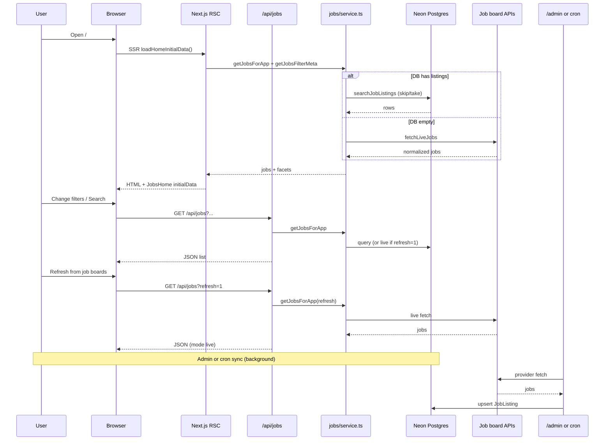
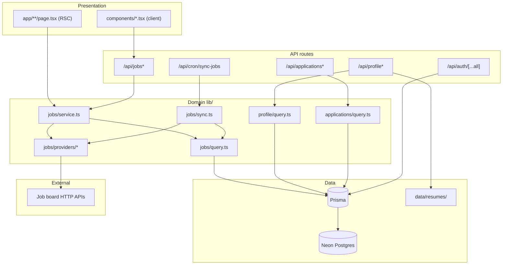

# WhatsMyJob

**WhatsMyJob** is a personal job-search hub: one web app where you discover roles from many boards, read full listings without tab-hopping, keep your seeker profile in one place, and track every application you submit.

### What problem it solves

Job hunting is fragmented. Remotive, RemoteOK, Adzuna, JSearch (Google for Jobs), and other feeds each have their own site and filters. WhatsMyJob **aggregates those official APIs** into a single searchable catalog, stores listings in Postgres for fast repeat visits, and still lets you **refresh from live sources** when you want the newest posts.

You apply on the **original listing** (external link)—this app does not replace employer ATS portals. It helps you **find**, **compare**, and **organize** the hunt on your side.

### Who it is for

- **Job seekers** browsing remote, hybrid, or on-site roles (especially useful with JSearch for Philippines and US coverage).
- **Signed-in users** who want a profile (resume, cover letter, links), an application tracker (status, notes, replies), and a consistent UI across devices.
- **Admins** (you, on your instance) who sync provider data into Neon so the home page loads quickly for everyone.

### How it works at a glance

1. **Discover** — Filter by keyword, source, type, location, and category; open jobs in a fixed three-column layout (filters | list | detail).
2. **Load from database** — After sync, normal page loads read Postgres (fast). Live APIs run on **Refresh** or when the DB is empty.
3. **Apply elsewhere** — Each card links out to the source’s apply URL.
4. **Stay organized** — Log applications, update pipeline status, and maintain profile assets in one account.

Built with **Next.js 16**, **React 19**, **Neon Postgres**, **Prisma**, and **Better Auth**.

---

## Features

| Area | What you get |
|------|----------------|
| **Jobs home** (`/`) | Fixed three-column layout (filters \| list \| detail); manual **Search**; recency badges; virtual list only for 80+ rows |
| **Data** | **Database-first** when Neon has listings; live APIs as fallback or on **Refresh**; admin/cron sync writes to Postgres |
| **Profile** (`/profile`) | Headline, bio, skills, work preferences, cover letter, contact email, LinkedIn / portfolio / GitHub; resume upload (PDF/Word, 5 MB) stored on disk |
| **Applications** (`/analytics`) | Track where you applied, status pipeline, notes, reply flag |
| **Admin** (`/admin`) | Sync all or one job source; view sync logs and DB stats |
| **Auth** | Email/password via Better Auth; roles `user` / `admin` |
| **UX** | Global loading overlay on navigation and sign-in/out; route-level `loading.tsx` shells |

---

## Tech stack

### Core

| Layer | Package / service | Version (see `package.json`) | Role |
|-------|-------------------|------------------------------|------|
| Framework | [Next.js](https://nextjs.org/) | 16.x | App Router, RSC, API routes, Turbopack dev |
| UI runtime | [React](https://react.dev/) | 19.x | Server + client components |
| Language | TypeScript | 5.7.x | Strict typing across app and `lib/` |
| Styling | [Tailwind CSS](https://tailwindcss.com/) | 4.x | Utility-first CSS (`@tailwindcss/postcss`) |
| Components | [shadcn/ui](https://ui.shadcn.com/) + [Radix UI](https://www.radix-ui.com/) | various | Accessible primitives (dialog, select, tabs, etc.) |
| Icons | [lucide-react](https://lucide.dev/) | — | Nav and UI icons |
| Database | [Neon](https://neon.tech) Postgres | — | Hosted PostgreSQL |
| ORM | [Prisma](https://www.prisma.io/) | 6.x | Schema, client, `db push` |
| Auth | [Better Auth](https://www.better-auth.com/) | 1.6.x | Sessions, email/password, Prisma adapter |
| Validation | [Zod](https://zod.dev/) | 3.x | API/input shapes where used |
| Forms | [react-hook-form](https://react-hook-form.com/) + [@hookform/resolvers](https://github.com/react-hook-form/resolvers) | — | Profile and auth forms |

### UI & layout utilities

| Library | Purpose |
|---------|---------|
| `class-variance-authority`, `clsx`, `tailwind-merge` | Component variants and class merging |
| `@tanstack/react-virtual` | Virtual scrolling when job lists exceed 80 rows (search results) |
| `date-fns` | Dates in cards and applications |
| `next-themes` | Theme plumbing (if enabled in layout) |
| `sonner` | Toast notifications |
| `embla-carousel-react`, `vaul`, `cmdk`, `input-otp` | shadcn/ui building blocks |
| `@vercel/analytics` | Optional analytics hook in layout |

### Server / tooling

| Library | Purpose |
|---------|---------|
| `kysely` | Pinned dependency (Better Auth / adapter peer resolution) |
| `dotenv-cli` | Dev scripts that load `.env.local` |
| `tsx` | Run `scripts/*.ts` without compiling |
| `tw-animate-css` | Animation utilities for Tailwind |

### Next.js configuration (`next.config.mjs`)

- **`experimental.optimizePackageImports`** — tree-shakes `lucide-react`, `date-fns`, `@tanstack/react-virtual`, and common Radix packages
- **`serverExternalPackages`** — `prisma`, `@prisma/client`, `better-auth` kept external on the server bundle
- **`turbopack`** — dev root and `kysely` resolve alias
- **`images.remotePatterns`** — favicon/avatar hosts for company logos

---

## How the system works

WhatsMyJob separates **ingestion** (pulling jobs from boards) from **serving** (showing jobs to users). Users almost always read from Postgres; external APIs run on sync, refresh, or when the database is empty.

### Three data modes

| Mode | When | Source | Typical speed |
|------|------|--------|----------------|
| **`database`** | Neon has rows and user is browsing (default) | `JobListing` via Prisma | Fast (ms–low hundreds of ms) |
| **`live`** | DB empty, or service falls back | `lib/jobs/live-fetch.ts` → provider APIs | Slow (seconds; rate limits possible) |
| **`refresh`** | User clicks **Refresh from job boards** (`?refresh=1`) | Live APIs, newest-first; may fall back to DB if APIs fail | Slow, intentional |

Decision logic lives in `lib/jobs/service.ts` → `getJobsForApp()`.

### End-to-end flow



### Ingestion (sync)

1. **Admin UI** — `POST /api/jobs/sync` (admin session) calls `lib/jobs/sync.ts`.
2. **Optional cron** — `GET /api/cron/sync-jobs` with `Authorization: Bearer $CRON_SECRET` (for Vercel Cron or external scheduler).
3. Each provider implements `fetch` in `lib/jobs/providers/*`, returns normalized rows.
4. Sync **upserts** by `(sourceId, externalId)` into `JobListing`, updates `JobSource` stats and `JobSyncLog`.

Sync does **not** replace the whole table on each run—it merges new/updated rows. The full corpus stays searchable; home browse uses `offset` / **Load more** for pagination.

### Serving (browse)

1. **SSR** — `app/page.tsx` → `loadHomeInitialData()` loads list + sidebar facets in parallel (`React.cache` for session).
2. **Client** — `components/jobs-home.tsx` hydrates from SSR; skips duplicate fetch only when SSR returned rows.
3. **List API** — `GET /api/jobs` with `meta=0` for fast list-only updates; `GET /api/jobs/meta` for filter facets.
4. **Pagination** — Response includes `offset` (DB skip used). Load more sends `offset = previousOffset + jobs.length`.
5. **Logos** — `enrichJobsWithLogos()` fills missing logos from DB scope lookup + favicon fallback; `/api/logo` proxies blocked URLs.

### Auth & roles

| Role | Jobs browse | Profile / applications | Admin sync |
|------|-------------|------------------------|------------|
| Guest | Yes (limited list size) | No | No |
| `user` | Yes | Yes | No |
| `admin` | Yes | Yes | Yes |

Better Auth stores users in Postgres; `role` is on `User` (default `user`). Guards: `lib/auth-guards.ts` (pages), `lib/api-auth.ts` (API).

---

## Architecture

### Layer diagram



### Jobs module map

| File / folder | Responsibility |
|---------------|----------------|
| `lib/jobs/service.ts` | Orchestration: DB vs live vs refresh, facets, messages |
| `lib/jobs/query.ts` | Prisma list/search, counts, facets, `hasAnyJobListings` |
| `lib/jobs/sync.ts` | Admin sync: upsert batches, sync logs |
| `lib/jobs/live-fetch.ts` | Parallel provider fetch for live/refresh |
| `lib/jobs/filters.ts` | Parse URL params, apply filters, facet merge |
| `lib/jobs/providers/*` | One module per board API |
| `lib/jobs/enrich-logos.ts` | Logo backfill without live API on every request |
| `lib/home-initial-data.ts` | SSR bootstrap for jobs home |
| `components/jobs-home.tsx` | Client state, fetch, three-pane UI |
| `components/jobs-resizable-layout.tsx` | Fixed filters \| list \| detail columns |

### Request flow (jobs home) — summary

1. **SSR** — `loadHomeInitialData()`: `getJobsForApp(..., { includeMeta: false })` + `getJobsFilterMeta()` in parallel.
2. **Hydration** — If SSR returned jobs, client keeps them; otherwise fetches `GET /api/jobs`.
3. **Filter change** — Client calls `/api/jobs` (+ `/api/jobs/meta` when facets needed).
4. **Refresh** — `?refresh=1` bypasses DB read path and hits live APIs.
5. **Detail** — Selected job from list state; full description from list row or `GET /api/jobs/[id]`.

---

## App routes (pages)

| Path | Auth | Description |
|------|------|-------------|
| `/` | Public | Jobs board (split view, filters, detail) |
| `/login`, `/register` | Redirect if already signed in | Email/password auth |
| `/profile` | Required | Job-seeker profile + resume |
| `/analytics` | Required | **Applications** tracker (nav label: “Applications”) |
| `/admin` | Admin | Source sync dashboard |
| `/not-found` | — | 404 page |

Layouts use `components/page-shell.tsx` (dynamic navbar), `components/app-loading-provider.tsx` (global loading), and route `loading.tsx` where present.

---

## HTTP API reference

All JSON routes return `{ error: string, detail?: string }` on failure unless noted. Base URL: your app origin. Session cookies via Better Auth.

### Auth helpers

| Helper | Location | Returns |
|--------|----------|---------|
| `getApiSession()` | `lib/api-auth.ts` | Session or null |
| `requireSessionApi()` | `lib/api-auth.ts` | `{ session }` or 401 |
| `requireAdminApi()` | `lib/api-auth.ts` | `{ session }` or 401/403 |
| `getCachedSession()` | `lib/auth-session.ts` | SSR session (`React.cache`) |

### Auth

| Method | Path | Auth | Description |
|--------|------|------|-------------|
| * | `/api/auth/[...all]` | — | Better Auth: sign-up, sign-in, sign-out, session. [Docs](https://www.better-auth.com/docs) |

Client: `lib/auth-client.ts`.

### Jobs (public read)

#### `GET /api/jobs`

Main list/search → `getJobsForApp()` in `lib/jobs/service.ts`.

Query parameters (parsed in `lib/jobs/filters.ts`):

| Parameter | Example | Description |
|-----------|---------|-------------|
| `q` | `react` | Search title, company, location, description |
| `source` | `remotive` | Filter by board id (repeatable) |
| `sources` | `remotive,jobicy` | Comma-separated source ids |
| `type` | `remote` | Job type substring match |
| `location` | `Manila` | Location substring match |
| `category` | `it` | Category id (`lib/jobs/categories.ts`) |
| `limit` | `40` | Page size (40 browse, 150 search, max 200) |
| `offset` | `40` | Pagination skip; response echoes `offset` for load-more |
| `refresh` | `1` | Live provider APIs (newest first), skips DB |
| `meta` | `0` | Omit facets (faster list-only fetch) |

**Response `200`:** `{ jobs, stats, totalMatching, hasMore, offset, sources?, types?, locationSuggestions?, filters, mode, message?, providerErrors? }`

| Field | Meaning |
|-------|---------|
| `mode` | `"database"` or `"live"` |
| `offset` | DB slice start — next page: `offset + jobs.length` |
| `hasMore` | More rows match filters beyond this page |
| `providerErrors` | Failed boards on live/refresh |

**Cache-Control:** `no-store` on refresh/default browse; else `private, max-age=15`.

#### `GET /api/jobs/meta`

Same filter params as `/api/jobs` (no `refresh`). Returns `{ sources, types, locationSuggestions, totalMatching }` only. Cached 60s.

#### `GET /api/jobs/[id]`

Single job by Prisma id (full description). `200` `{ job }` · `404` if missing.

#### `GET /api/jobs/stats`

`{ totalJobs, locationCount, companyCount, mode? }`

#### `GET /api/logo?url=https://...`

Logo proxy (SSRF-safe). Returns image bytes.

### Jobs (admin)

Requires admin role.

#### `GET /api/jobs/sources`

Dashboard: `{ sources, logs, configured, stats }`.

#### `POST /api/jobs/sync`

| Body | Action |
|------|--------|
| `{}` | Sync all providers |
| `{ "sourceId": "remotive" }` | Sync one provider |

Upserts via `lib/jobs/sync.ts`. `maxDuration` 300s.

#### `GET /api/cron/sync-jobs`

Scheduled sync. Header `Authorization: Bearer $CRON_SECRET`. Requires `CRON_SECRET` env. Same as sync all.

### Profile (signed-in)

| Method | Path | Description |
|--------|------|-------------|
| GET | /api/profile | Get/create profile |
| PATCH | /api/profile | Update UpdateProfileInput |
| GET | /api/profile/resume | Download resume |
| POST | /api/profile/resume | Upload ile (PDF/Word, 5 MB) |
| DELETE | /api/profile/resume | Remove resume |

Storage: data/resumes/<userId>/

### Applications (signed-in)

| Method | Path | Description |
|--------|------|-------------|
| GET | /api/applications | List applications |
| POST | /api/applications | Create (	itle, company required) |
| PATCH | /api/applications/[id] | Update status, notes, reply flag |

Statuses: pplied, screening, interview, offer, 
ejected, withdrawn, 
o_reply.

---

## External job APIs (providers)

Ingestion uses **official HTTP APIs** only (no HTML scraping). Implementations live under `lib/jobs/providers/`.

| Source id | API keys | Provider file | Notes |
|-----------|----------|---------------|--------|
| `remotive` | — | `remotive.ts` | Remote tech |
| `arbeitnow` | — | `arbeitnow.ts` | EU / remote friendly |
| `jobicy` | — | `jobicy.ts` | Remote (batch size limited by API) |
| `remoteok` | — | `remoteok.ts` | Remote |
| `remotejobs` | — | `remotejobs-org.ts` | Paginated remote |
| `careernest` | — | (career nest provider) | Global feed |
| `jsearch` | `JSEARCH_API_KEY` or `RAPIDAPI_KEY` | `jsearch.ts` | Google for Jobs aggregator |
| `reed` | `REED_API_KEY` | — | UK |
| `adzuna` | `ADZUNA_APP_ID`, `ADZUNA_APP_KEY` | `adzuna.ts` | US / SG / UK / EU (no PH) |

Catalog metadata: `lib/jobs/sources-catalog.ts`.

**Behavior**

- **Default browse** — If `JobListing` has rows, `GET /api/jobs` reads Postgres (fast). Ordered by `postedAt` / `syncedAt` desc with `offset` pagination.
- **Empty DB** — Service falls back to `fetchLiveJobs()` until admin/cron sync populates Neon.
- **Refresh** — `?refresh=1` always hits live APIs; upsert happens only via sync endpoints, not on every refresh.
- **Logos** — `lib/jobs/enrich-logos.ts`, `resolve-logo.ts`, favicon fallback, `/api/logo` proxy.

### Recommended env for Philippines + US

```env
JSEARCH_API_KEY=your_key
JSEARCH_COUNTRIES=ph,us
ADZUNA_APP_ID=your_id
ADZUNA_APP_KEY=your_key
ADZUNA_COUNTRIES=us,sg
```

Philippines-focused search relies mainly on **JSearch** (`country=ph`). Adzuna has no PH feed; `sg` adds regional listings.

---

## Environment variables

Copy `.env.example` → `.env.local`.

| Variable | Required | Description |
|----------|----------|-------------|
| `DATABASE_URL` | Yes | Neon PostgreSQL URL (`?sslmode=require`) |
| `BETTER_AUTH_SECRET` | Yes | Session signing secret (`openssl rand -base64 32`) |
| `BETTER_AUTH_URL` | Yes | App origin, e.g. `http://localhost:3000` |
| `NEXT_PUBLIC_APP_URL` | Yes | Same origin for client-side auth URLs |
| `JSEARCH_API_KEY` | No | OpenWebNinja JSearch |
| `RAPIDAPI_KEY` | No | Alternative JSearch key |
| `JSEARCH_QUERY` | No | Default search query |
| `JSEARCH_COUNTRIES` | No | e.g. `ph,us` |
| `JSEARCH_NUM_PAGES` | No | Pages per sync |
| `JSEARCH_QUERIES` | No | Advanced: `query\|country` pairs |
| `ADZUNA_APP_ID` / `ADZUNA_APP_KEY` | No | Adzuna API |
| `ADZUNA_COUNTRIES` | No | e.g. `us,sg` |
| `ADZUNA_DEFAULT_WHAT` / `ADZUNA_DEFAULT_WHERE` | No | Default Adzuna search |
| `REED_API_KEY` | No | Reed.co.uk |
| `CRON_SECRET` | No | Bearer token for `GET /api/cron/sync-jobs` (scheduled sync) |

---

## Database schema (Prisma)

File: `prisma/schema.prisma`. Apply with `npm run db:push`.

| Model | Purpose |
|-------|---------|
| `User` | Auth user + `role` (`user` / `admin`) |
| `Session`, `Account`, `Verification` | Better Auth tables |
| `UserProfile` | Job-seeker fields, resume metadata, skills JSON |
| `JobSource` | Configured board + last sync status |
| `JobListing` | Normalized job rows (`sourceId` + `externalId` unique) |
| `JobSyncLog` | Per-source sync history |
| `JobApplication` | Per-user application tracking |

---

## Quick start

```bash
git clone https://github.com/DogoeDude/WhatsMyJob.git
cd WhatsMyJob
npm install
cp .env.example .env.local   # edit DATABASE_URL, BETTER_AUTH_*, NEXT_PUBLIC_APP_URL
npm run db:push
npm run db:generate
npm run dev
```

Open [http://localhost:3000](http://localhost:3000).

> **Tip:** Remotive, Arbeitnow, Jobicy, RemoteOK, RemoteJobs.org, and Career Nest work without API keys. Add JSearch for Philippines + US coverage.

### Admin access

| Step | Action |
|------|--------|
| 1 | Register at `/register` (default role: `user`) |
| 2 | `npx tsx scripts/make-admin.ts your@email.com` |
| 3 | Sign in — admins can open `/admin` and run **Sync all sources** |

### First data load

1. Promote admin (above), sign in.
2. **Admin** → **Sync all sources** (or call `POST /api/jobs/sync` as admin).
3. Open **Jobs** (`/`) — listings load from Postgres; use **Refresh from job boards** for a live API pass.

Optional: set `CRON_SECRET` and schedule `GET /api/cron/sync-jobs` (e.g. Vercel Cron every hour) to keep the catalog updated automatically.

---

## npm scripts

| Command | Description |
|---------|-------------|
| `npm run dev` | Dev server with **Turbopack** (`next dev --turbopack`) |
| `npm run dev:webpack` | Dev server with Webpack (fallback if Turbopack issues) |
| `npm run build` | Production build |
| `npm run start` | Run production server |
| `npm run lint` | ESLint |
| `npm run db:push` | Push Prisma schema to Neon |
| `npm run db:generate` | Regenerate Prisma client |

**Utility scripts (not in `package.json`; run with `npx tsx`):**

| Script | Usage |
|--------|--------|
| `scripts/make-admin.ts` | `npx tsx scripts/make-admin.ts <email>` |
| `scripts/test-providers.ts` | Smoke-test provider fetch (needs `.env.local`) |
| `scripts/test-live-jobs.ts` | Live jobs integration check |

**Prisma Studio:** `npx prisma studio` (after `db:generate`).

---

## Project layout

```
app/
  layout.tsx                 # Root layout, session, AppLoadingProvider
  page.tsx                   # Jobs home (SSR initial data)
  loading.tsx                # Route loading UI
  login/ register/           # Auth pages + layouts (redirect if authed)
  profile/                   # Profile page + loading.tsx
  analytics/                 # Applications dashboard
  admin/                     # Sync dashboard (admin layout)
  api/
    auth/[...all]/route.ts   # Better Auth
    cron/sync-jobs/route.ts  # Scheduled sync (Bearer CRON_SECRET)
    jobs/route.ts            # List + search
    jobs/meta/route.ts       # Filter facets
    jobs/[id]/route.ts       # Single job
    jobs/stats/route.ts      # Aggregate stats
    jobs/sources/route.ts    # Admin source status
    jobs/sync/route.ts       # Admin sync (POST)
    applications/            # CRUD applications
    profile/                 # Profile + resume
    logo/route.ts            # Logo proxy
components/
  jobs-home.tsx              # Main jobs client UI
  jobs-sidebar.tsx           # Filters + search
  jobs-resizable-layout.tsx  # Fixed three-column layout
  jobs-flat-virtual-list.tsx # List (virtual when 80+ jobs)
  jobs-board-layout.tsx      # JobsPane scroll regions
  job-detail-panel*.tsx      # Detail pane
  navbar.tsx                 # Header + mobile bottom tabs
  profile-form.tsx           # Profile sections
  applications-dashboard.tsx
  app-loading-provider.tsx   # Global navigation loading
  loading-indicator.tsx      # Spinner primitives
  ui/                        # shadcn components
lib/
  auth.ts, auth-session.ts, auth-guards.ts, auth-client.ts
  home-initial-data.ts       # SSR jobs bootstrap
  jobs/                      # service, query, sync, providers, filters, recency
  profile/                   # query, types, resume storage
  applications/              # query, statuses, types
  api-auth.ts                # requireSessionApi / requireAdminApi
  nav-links.ts               # Site navigation definitions
prisma/schema.prisma
scripts/                     # make-admin, test providers
data/resumes/                # Uploaded resumes (gitignored)
```

---

## Troubleshooting

| Issue | What to try |
|-------|-------------|
| **Prisma `EPERM` on `db:generate`** | Stop `npm run dev`, then `npm run db:generate` |
| **Port 3000 in use** | Kill duplicate `node` / `next dev` processes |
| **`NEXT_REDIRECT` on login/register** | Expected when already signed in; guards use `redirect()` without try/catch (`lib/auth-guards.ts`) |
| **Failed to load jobs** | Check `DATABASE_URL`, run `db:push`, regenerate client; run admin **Sync all sources** |
| **Empty list but sidebar shows counts** | Hard refresh (`Ctrl+Shift+R`); click **Refresh from job boards**; ensure sync completed |
| **Only filters column visible** | Hard refresh; old resizable-panel localStorage is cleared on load automatically |
| **Sparse sources on page 1** | Admin sync all sources; use **Refresh** for live mix |
| **Letter avatars instead of logos** | Some boards block server fetch; favicon + `/api/logo` fallback |
| **Resume upload fails** | PDF or Word only, ≤ 5 MB; ensure `data/resumes` is writable |
| **Turbopack oddities** | `npm run dev:webpack` |

---

## License

Private project — all rights reserved unless stated otherwise.
