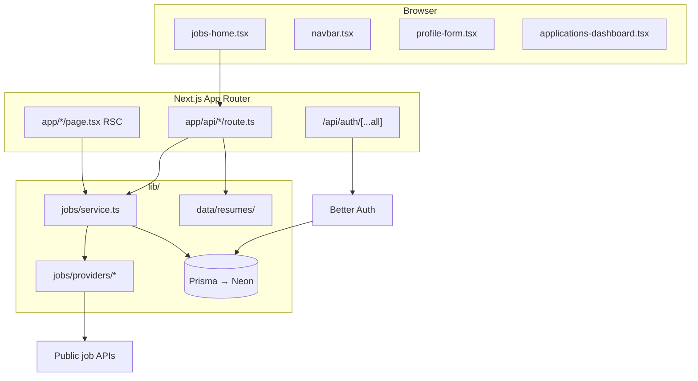

# WhatsMyJob

**WhatsMyJob** is a personal job-search hub: one web app where you discover roles from many boards, read full listings without tab-hopping, keep your seeker profile in one place, and track every application you submit.

### What problem it solves

Job hunting is fragmented. Remotive, RemoteOK, Adzuna, JSearch (Google for Jobs), and other feeds each have their own site and filters. WhatsMyJob **aggregates those official APIs** into a single searchable catalog, stores listings in Postgres for fast repeat visits, and still lets you **refresh from live sources** when you want the newest posts.

You apply on the **original listing** (external link)—this app does not replace employer ATS portals. It helps you **find**, **compare**, and **organize** the hunt on your side.

### Who it is for

- **Job seekers** browsing remote, hybrid, or on-site roles (especially useful with JSearch for Philippines and US coverage).
- **Signed-in users** who want a profile (resume, cover letter, links), an application tracker (status, notes, replies), and a consistent UI across devices.
- **Admins** (you, on your instance) who sync provider data into Neon so the home page loads quickly for everyone.

### How it works at a glance

1. **Discover** — Filter by keyword, source, type, location, and category; open jobs in a three-pane layout (filters | list | detail).
2. **Persist** — Optional admin sync copies provider results into the database; day-to-day browsing reads from there.
3. **Apply elsewhere** — Each card links out to the source’s apply URL.
4. **Stay organized** — Log applications, update pipeline status, and maintain profile assets in one account.

Built with **Next.js 16**, **React 19**, **Neon Postgres**, **Prisma**, and **Better Auth**.

---

## Features

| Area | What you get |
|------|----------------|
| **Jobs home** (`/`) | Resizable filters \| list \| detail panels; manual **Search** (no auto-search while typing); recency badges (Latest / New / Recent); virtualized list for large result sets |
| **Data** | Live provider APIs when the DB is empty; cached reads from Postgres after admin sync; **Refresh** fetches live APIs again |
| **Profile** (`/profile`) | Headline, bio, skills, work preferences, cover letter, contact email, LinkedIn / portfolio / GitHub; resume upload (PDF/Word, 5 MB) stored on disk |
| **Applications** (`/analytics`) | Track where you applied, status pipeline, notes, reply flag |
| **Admin** (`/admin`) | Sync all or one job source; view sync logs and DB stats |
| **Auth** | Email/password via Better Auth; roles `user` / `admin` |
| **UX** | Global loading overlay on navigation and sign-in/out; route-level `loading.tsx` shells |

---

## Tech stack

### Core

| Layer | Package / service | Version (see `package.json`) | Role |
|-------|-------------------|------------------------------|------|
| Framework | [Next.js](https://nextjs.org/) | 16.x | App Router, RSC, API routes, Turbopack dev |
| UI runtime | [React](https://react.dev/) | 19.x | Server + client components |
| Language | TypeScript | 5.7.x | Strict typing across app and `lib/` |
| Styling | [Tailwind CSS](https://tailwindcss.com/) | 4.x | Utility-first CSS (`@tailwindcss/postcss`) |
| Components | [shadcn/ui](https://ui.shadcn.com/) + [Radix UI](https://www.radix-ui.com/) | various | Accessible primitives (dialog, select, tabs, etc.) |
| Icons | [lucide-react](https://lucide.dev/) | — | Nav and UI icons |
| Database | [Neon](https://neon.tech) Postgres | — | Hosted PostgreSQL |
| ORM | [Prisma](https://www.prisma.io/) | 6.x | Schema, client, `db push` |
| Auth | [Better Auth](https://www.better-auth.com/) | 1.6.x | Sessions, email/password, Prisma adapter |
| Validation | [Zod](https://zod.dev/) | 3.x | API/input shapes where used |
| Forms | [react-hook-form](https://react-hook-form.com/) + [@hookform/resolvers](https://github.com/react-hook-form/resolvers) | — | Profile and auth forms |

### UI & layout utilities

| Library | Purpose |
|---------|---------|
| `class-variance-authority`, `clsx`, `tailwind-merge` | Component variants and class merging |
| `react-resizable-panels` | Jobs page three-pane layout |
| `@tanstack/react-virtual` | Virtual scrolling for long job lists |
| `date-fns` | Dates in cards and applications |
| `next-themes` | Theme plumbing (if enabled in layout) |
| `sonner` | Toast notifications |
| `embla-carousel-react`, `vaul`, `cmdk`, `input-otp` | shadcn/ui building blocks |
| `@vercel/analytics` | Optional analytics hook in layout |

### Server / tooling

| Library | Purpose |
|---------|---------|
| `kysely` | Pinned dependency (Better Auth / adapter peer resolution) |
| `dotenv-cli` | Dev scripts that load `.env.local` |
| `tsx` | Run `scripts/*.ts` without compiling |
| `tw-animate-css` | Animation utilities for Tailwind |

### Next.js configuration (`next.config.mjs`)

- **`experimental.optimizePackageImports`** — tree-shakes `lucide-react`, `date-fns`, `@tanstack/react-virtual`, and common Radix packages
- **`serverExternalPackages`** — `prisma`, `@prisma/client`, `better-auth` kept external on the server bundle
- **`turbopack`** — dev root and `kysely` resolve alias
- **`images.remotePatterns`** — favicon/avatar hosts for company logos

---

## Architecture



**Request flow (jobs home)**

1. **SSR** — `app/page.tsx` calls `loadHomeInitialData()` (`lib/home-initial-data.ts`): parallel job list + filter metadata, using `React.cache` for session (`lib/auth-session.ts`).
2. **Client browse** — `components/jobs-home.tsx` calls `GET /api/jobs` with filters; `meta=0` skips heavy facet work on list fetches; `GET /api/jobs/meta` loads facets when needed.
3. **Refresh** — `?refresh=1` on `/api/jobs` pulls from live providers (newest-first ordering in the service layer).
4. **Persisted corpus** — Admin `POST /api/jobs/sync` writes to `JobListing` / `JobSource` / `JobSyncLog` via `lib/jobs/sync.ts`.

---

## App routes (pages)

| Path | Auth | Description |
|------|------|-------------|
| `/` | Public | Jobs board (split view, filters, detail) |
| `/login`, `/register` | Redirect if already signed in | Email/password auth |
| `/profile` | Required | Job-seeker profile + resume |
| `/analytics` | Required | **Applications** tracker (nav label: “Applications”) |
| `/admin` | Admin | Source sync dashboard |
| `/not-found` | — | 404 page |

Layouts use `components/page-shell.tsx` (dynamic navbar), `components/app-loading-provider.tsx` (global loading), and route `loading.tsx` where present.

---

## HTTP API reference

All JSON routes return `{ error: string }` on failure unless noted. Session cookies are set by Better Auth.

### Auth

| Method | Path | Auth | Description |
|--------|------|------|-------------|
| * | `/api/auth/[...all]` | — | Better Auth handler (sign-in, sign-up, sign-out, session). See [Better Auth docs](https://www.better-auth.com/docs). |

Client: `lib/auth-client.ts`. Server session: `auth.api.getSession()` / `getCachedSession()` in `lib/auth-session.ts`.

### Jobs (public)

#### `GET /api/jobs`

Query parameters (parsed in `lib/jobs/filters.ts`):

| Parameter | Example | Description |
|-----------|---------|-------------|
| `q` | `react` | Search title, company, location, description |
| `source` | `remotive` | Filter by board id (repeatable) |
| `sources` | `remotive,jobicy` | Comma-separated source ids |
| `type` | `remote` | Job type substring match |
| `location` | `Manila` | Location substring match |
| `category` | `it` | Category id (`lib/jobs/categories.ts`) |
| `limit` | `50` | Page size (capped by `lib/jobs/limits.ts`) |
| `offset` | `50` | Pagination offset |
| `refresh` | `1` | Fetch from **live** provider APIs |
| `meta` | `0` | Omit filter facets from response (faster list loads) |

**Response (200):** `{ jobs, stats, totalMatching, hasMore, offset, sources?, types?, locationSuggestions?, filters, mode, message?, providerErrors? }`

- `mode`: e.g. `database` vs live provider mix (see `lib/jobs/service.ts`).
- Cache: `private, max-age=15` (or `no-store` when `refresh=1`).

#### `GET /api/jobs/meta`

Same filter query params as `/api/jobs` (no `refresh`). Returns facet metadata only: source counts, types, locations, `totalMatching`.

#### `GET /api/jobs/[id]`

Single listing by Prisma `JobListing.id`. **404** if missing.

#### `GET /api/jobs/stats`

Aggregate counts for the app (total jobs, companies, locations) via `getAppJobStats()`.

#### `GET /api/logo?url=...`

Proxies a remote company logo URL (SSRF-safe host checks). Used when boards block hotlinking.

### Jobs (admin)

| Method | Path | Auth | Description |
|--------|------|------|-------------|
| `GET` | `/api/jobs/sources` | Admin | DB sources, recent sync logs, configured providers |
| `POST` | `/api/jobs/sync` | Admin | Sync all providers, or body `{ "sourceId": "remotive" }` for one. `maxDuration` 300s |

### Profile (signed-in)

| Method | Path | Body / input | Description |
|--------|------|--------------|-------------|
| `GET` | `/api/profile` | — | User profile (auto-created if missing) |
| `PATCH` | `/api/profile` | `UpdateProfileInput` JSON | Update fields (name, headline, skills, URLs, cover letter, etc.) |
| `GET` | `/api/profile/resume` | — | Download resume file (attachment) |
| `POST` | `/api/profile/resume` | `multipart/form-data` field `file` | Upload PDF/Word (max 5 MB) |
| `DELETE` | `/api/profile/resume` | — | Remove resume file + metadata |

Resume files: `data/resumes/<userId>/` (gitignored). Constants: `lib/profile/resume-constants.ts`.

### Applications (signed-in)

| Method | Path | Body | Description |
|--------|------|------|-------------|
| `GET` | `/api/applications` | — | List current user’s applications |
| `POST` | `/api/applications` | `{ jobListingId?, title, company, location?, applyUrl?, source? }` | Create application (`title` + `company` required) |
| `PATCH` | `/api/applications/[id]` | `{ status?, hasReply?, notes? }` | Update; `status` must be one of `lib/applications/statuses.ts` |

**Application statuses:** `applied`, `screening`, `interview`, `offer`, `rejected`, `withdrawn`, `no_reply`.

---

## External job APIs (providers)

Ingestion uses **official HTTP APIs** only (no HTML scraping). Implementations live under `lib/jobs/providers/`.

| Source id | API keys | Provider file | Notes |
|-----------|----------|---------------|--------|
| `remotive` | — | `remotive.ts` | Remote tech |
| `arbeitnow` | — | `arbeitnow.ts` | EU / remote friendly |
| `jobicy` | — | `jobicy.ts` | Remote (batch size limited by API) |
| `remoteok` | — | `remoteok.ts` | Remote |
| `remotejobs` | — | `remotejobs-org.ts` | Paginated remote |
| `careernest` | — | (career nest provider) | Global feed |
| `jsearch` | `JSEARCH_API_KEY` or `RAPIDAPI_KEY` | `jsearch.ts` | Google for Jobs aggregator |
| `reed` | `REED_API_KEY` | — | UK |
| `adzuna` | `ADZUNA_APP_ID`, `ADZUNA_APP_KEY` | `adzuna.ts` | US / SG / UK / EU (no PH) |

Catalog metadata: `lib/jobs/sources-catalog.ts`.

**Behavior**

- **Empty DB** — Home can show live provider results.
- **After sync** — Reads prefer Postgres; UI **Refresh** uses `refresh=1` for live APIs.
- **Logos** — `lib/jobs/resolve-logo.ts`, `enrich-logos.ts`, favicon fallbacks, `/api/logo` proxy.

### Recommended env for Philippines + US

```env
JSEARCH_API_KEY=your_key
JSEARCH_COUNTRIES=ph,us
ADZUNA_APP_ID=your_id
ADZUNA_APP_KEY=your_key
ADZUNA_COUNTRIES=us,sg
```

Philippines-focused search relies mainly on **JSearch** (`country=ph`). Adzuna has no PH feed; `sg` adds regional listings.

---

## Environment variables

Copy `.env.example` → `.env.local`.

| Variable | Required | Description |
|----------|----------|-------------|
| `DATABASE_URL` | Yes | Neon PostgreSQL URL (`?sslmode=require`) |
| `BETTER_AUTH_SECRET` | Yes | Session signing secret (`openssl rand -base64 32`) |
| `BETTER_AUTH_URL` | Yes | App origin, e.g. `http://localhost:3000` |
| `NEXT_PUBLIC_APP_URL` | Yes | Same origin for client-side auth URLs |
| `JSEARCH_API_KEY` | No | OpenWebNinja JSearch |
| `RAPIDAPI_KEY` | No | Alternative JSearch key |
| `JSEARCH_QUERY` | No | Default search query |
| `JSEARCH_COUNTRIES` | No | e.g. `ph,us` |
| `JSEARCH_NUM_PAGES` | No | Pages per sync |
| `JSEARCH_QUERIES` | No | Advanced: `query\|country` pairs |
| `ADZUNA_APP_ID` / `ADZUNA_APP_KEY` | No | Adzuna API |
| `ADZUNA_COUNTRIES` | No | e.g. `us,sg` |
| `ADZUNA_DEFAULT_WHAT` / `ADZUNA_DEFAULT_WHERE` | No | Default Adzuna search |
| `REED_API_KEY` | No | Reed.co.uk |

---

## Database schema (Prisma)

File: `prisma/schema.prisma`. Apply with `npm run db:push`.

| Model | Purpose |
|-------|---------|
| `User` | Auth user + `role` (`user` / `admin`) |
| `Session`, `Account`, `Verification` | Better Auth tables |
| `UserProfile` | Job-seeker fields, resume metadata, skills JSON |
| `JobSource` | Configured board + last sync status |
| `JobListing` | Normalized job rows (`sourceId` + `externalId` unique) |
| `JobSyncLog` | Per-source sync history |
| `JobApplication` | Per-user application tracking |

---

## Quick start

```bash
git clone https://github.com/DogoeDude/WhatsMyJob.git
cd WhatsMyJob
npm install
cp .env.example .env.local   # edit DATABASE_URL, BETTER_AUTH_*, NEXT_PUBLIC_APP_URL
npm run db:push
npm run db:generate
npm run dev
```

Open [http://localhost:3000](http://localhost:3000).

> **Tip:** Remotive, Arbeitnow, Jobicy, RemoteOK, RemoteJobs.org, and Career Nest work without API keys. Add JSearch for Philippines + US coverage.

### Admin access

| Step | Action |
|------|--------|
| 1 | Register at `/register` (default role: `user`) |
| 2 | `npx tsx scripts/make-admin.ts your@email.com` |
| 3 | Sign in — admins can open `/admin` and run **Sync all sources** |

### First data load

1. Promote admin (above), sign in.
2. **Admin** → sync all sources (or rely on live APIs on first visit).
3. **Jobs** (`/`) — browse DB-backed listings; **Refresh** for live API pass.

---

## npm scripts

| Command | Description |
|---------|-------------|
| `npm run dev` | Dev server with **Turbopack** (`next dev --turbopack`) |
| `npm run dev:webpack` | Dev server with Webpack (fallback if Turbopack issues) |
| `npm run build` | Production build |
| `npm run start` | Run production server |
| `npm run lint` | ESLint |
| `npm run db:push` | Push Prisma schema to Neon |
| `npm run db:generate` | Regenerate Prisma client |

**Utility scripts (not in `package.json`; run with `npx tsx`):**

| Script | Usage |
|--------|--------|
| `scripts/make-admin.ts` | `npx tsx scripts/make-admin.ts <email>` |
| `scripts/test-providers.ts` | Smoke-test provider fetch (needs `.env.local`) |
| `scripts/test-live-jobs.ts` | Live jobs integration check |

**Prisma Studio:** `npx prisma studio` (after `db:generate`).

---

## Project layout

```
app/
  layout.tsx                 # Root layout, session, AppLoadingProvider
  page.tsx                   # Jobs home (SSR initial data)
  loading.tsx                # Route loading UI
  login/ register/           # Auth pages + layouts (redirect if authed)
  profile/                   # Profile page + loading.tsx
  analytics/                 # Applications dashboard
  admin/                     # Sync dashboard (admin layout)
  api/
    auth/[...all]/route.ts   # Better Auth
    jobs/route.ts            # List + search
    jobs/meta/route.ts       # Filter facets
    jobs/[id]/route.ts       # Single job
    jobs/stats/route.ts      # Aggregate stats
    jobs/sources/route.ts    # Admin source status
    jobs/sync/route.ts       # Admin sync
    applications/            # CRUD applications
    profile/                 # Profile + resume
    logo/route.ts            # Logo proxy
components/
  jobs-home.tsx              # Main jobs client UI
  jobs-sidebar.tsx           # Filters + search
  jobs-resizable-layout.tsx  # Three-pane layout
  jobs-flat-virtual-list.tsx # Virtual list
  job-detail-panel*.tsx      # Detail pane
  navbar.tsx                 # Header + mobile bottom tabs
  profile-form.tsx           # Profile sections
  applications-dashboard.tsx
  app-loading-provider.tsx   # Global navigation loading
  loading-indicator.tsx      # Spinner primitives
  ui/                        # shadcn components
lib/
  auth.ts, auth-session.ts, auth-guards.ts, auth-client.ts
  home-initial-data.ts       # SSR jobs bootstrap
  jobs/                      # service, query, sync, providers, filters, recency
  profile/                   # query, types, resume storage
  applications/              # query, statuses, types
  api-auth.ts                # requireSessionApi / requireAdminApi
  nav-links.ts               # Site navigation definitions
prisma/schema.prisma
scripts/                     # make-admin, test providers
data/resumes/                # Uploaded resumes (gitignored)
```

---

## Troubleshooting

| Issue | What to try |
|-------|-------------|
| **Prisma `EPERM` on `db:generate`** | Stop `npm run dev`, then `npm run db:generate` |
| **Port 3000 in use** | Kill duplicate `node` / `next dev` processes |
| **`NEXT_REDIRECT` on login/register** | Expected when already signed in; guards use `redirect()` without try/catch (`lib/auth-guards.ts`) |
| **Failed to load jobs** | Check `DATABASE_URL`, run `db:push`, regenerate client |
| **Sparse sources on page 1** | Admin sync all sources; use **Refresh** for live mix |
| **Letter avatars instead of logos** | Some boards block server fetch; favicon + `/api/logo` fallback |
| **Resume upload fails** | PDF or Word only, ≤ 5 MB; ensure `data/resumes` is writable |
| **Turbopack oddities** | `npm run dev:webpack` |

---

## License

Private project — all rights reserved unless stated otherwise.
